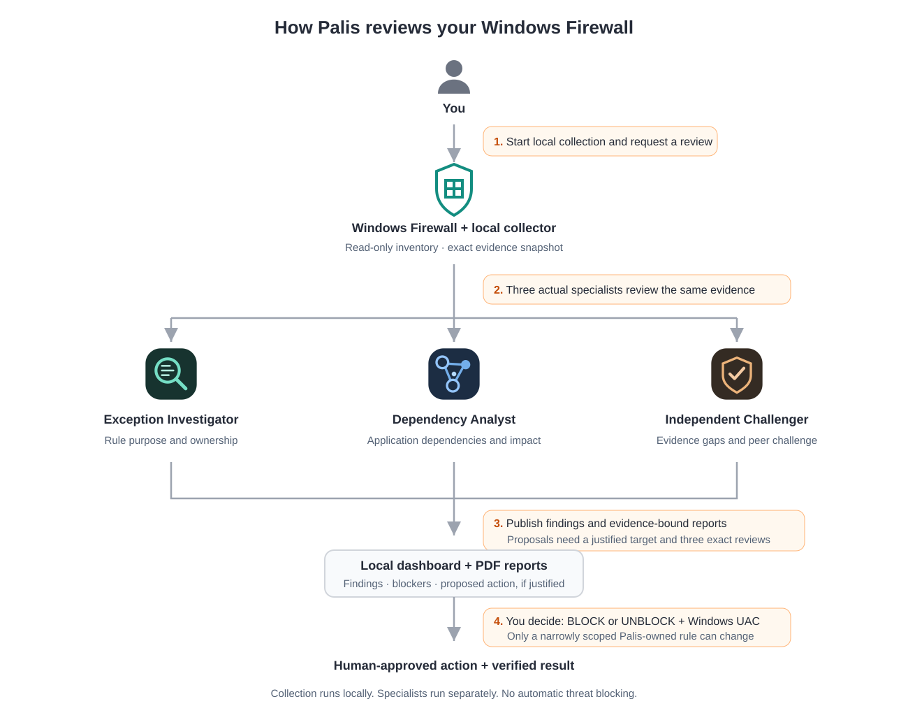

#  Palis — Evidence before action

A local Windows Firewall dashboard with three specialist agents that investigate rule exceptions, check application dependencies, and challenge findings before any change reaches you for approval.

## Project description

Firewall rules accumulate as applications are installed and updated. Some allow broad inbound access, some refer to development runtimes, and others serve dependencies that are easy to overlook. A rule that looks broad can still have a legitimate purpose. Removing or blocking it without understanding that purpose can break something you use.

Palis brings the configuration and the review into one local dashboard. A read-only collector captures Windows Firewall profiles and enabled inbound rules. Three actual specialists—the **Exception Investigator**, **Dependency Analyst**, and **Independent Challenger**—review the evidence from different angles. Their published findings, blockers, messages, and reports stay tied to the evidence they actually reviewed.

You decide whether a justified proposal should proceed. The separate executor requires three reviews of the exact proposal, your typed confirmation in the dashboard, and your acceptance of Windows UAC. Merely finding a broad rule never authorizes a block.

## Key features

- **Three specialists with clear roles.** Purpose and ownership, dependencies and impact, and independent evidence review.
- **Actual local evidence.** Profiles and enabled inbound rules come from read-only Windows commands.
- **Live collection and visible health.** Scans repeat after a 10-second wait; server-sent events update the browser. Collection status is separate from agent activity.
- **A searchable rule inventory.** Filter by action, profile, protocol, or remote scope; open full details or export CSV.
- **Evidence-bound reports.** Finished specialist assessments have PDF reports tied to their reviewed snapshots.
- **Human-controlled changes.** A narrowly scoped inbound block requires a justified target, three digest-bound reviews, dashboard confirmation, and UAC.
- **Controlled rollback.** A separate UNBLOCK decision can remove an exact, unchanged Palis-owned rule.
- **No invented activity.** The interface displays published work; it does not simulate agents, conversations, or findings.

## Safeguards

- **Collection is read-only.** The collector reads configuration without changing rules, profiles, or logging.
- **Broad scope is a review candidate.** It is not proof of malicious activity, an exposed listener, or a reason to block.
- **Ownership and impact must be established.** A proposal needs a specific real target, owner-confirmed purpose, dependency validation, and impact evidence.
- **All three specialists review the exact proposal.** Reviews bind to its digest. A changed proposal needs fresh reviews.
- **You approve every action.** Only you type BLOCK or UNBLOCK in the dashboard and accept Windows UAC. Agents must never call the approval endpoint on your behalf.
- **Existing rules stay untouched.** The constrained executor creates a new Palis-owned inbound rule. Rollback removes only the exact unchanged rule covered by its receipt.
- **Uncertainty stays visible.** Missing evidence, failed collection, cancellation, and unknown execution results must not appear as success.
- **Runtime data is excluded from this repository.** Machine evidence, assessment files, reports, logs, proposals, and private approval material are excluded from the source package. Any separately configured AI provider has its own data handling; this repository does not guarantee that an external coordinator processes evidence entirely on-device.

The full proposal contract, review receipts, execution checks, and rollback conditions are documented in [APPROVALS.md](APPROVALS.md). 

## Architecture

<p align="center">
  
</p>
<p align="center"><b>Figure 1. How Palis reviews your Windows Firewall</b></p>

### How it works, step by step

1. **You start Palis.** The Python server collects actual local profiles and enabled inbound rules through netsh, then serves the dashboard at the loopback address.
2. **The collector records evidence.** Each successful capture receives a timestamp and fingerprint. The latest capture replaces data/evidence.json; the monitoring loop saves newly changed captures under data/history and journals changes. Preserve a separate frozen snapshot for each actual review. The collector waits 10 seconds between scans; command duration adds to the interval.
3. **The coordinator assigns three actual specialists.** This happens in the associated agent-capable chat, outside the HTTP server.
   - **Exception Investigator** checks what a rule appears to serve, what ownership or purpose is established, and which exceptions need investigation.
   - **Dependency Analyst** checks application dependencies, scope, and the impact evidence needed before recommending a change.
   - **Independent Challenger** questions unsupported conclusions, looks for missing evidence, and reviews the proposed decision.
4. **The specialists publish their work.** Each updates its own JSON file with actual timestamps, findings, blockers, public activity summaries, and messages. Assessments retain the exact evidence snapshot reviewed.
5. **You inspect the dashboard and reports.** Configuration charts describe collected rules. The Reports view offers finished specialist PDFs. New evidence is flagged when it differs from an assessment baseline.
6. **A justified target may become a proposal.** It must identify one executable, protocol, local port, remote IP, and profile, with a reason, validation, and impact evidence. All three specialists review its exact digest.
7. **You decide whether to apply it.** You read the proposal, confirm BLOCK in the dashboard, and accept UAC yourself. The executor checks the scope and fresh state before creating a new Palis-owned rule.
8. **Palis verifies and reports the result.** Rule and filter checks determine the recorded outcome. Rule presence alone does not prove packet-level enforcement. Reversal requires a separate UNBLOCK confirmation and UAC.

### How the team coordinates and settles conflicts

The coordinator manages the specialists in the associated chat. The web server only reads their published files; it does not start models or manufacture a conversation.

- **One shared evidence basis.** Reviewers use the same frozen snapshot and identify gaps before drawing conclusions.
- **Independent peer challenge.** A dependency concern or unsupported ownership assumption remains a blocker until evidence resolves it.
- **Disagreements stay documented.** Specialists exchange actual messages and explain what supports or weakens a recommendation.
- **Baselines advance only after review.** Preserve the previous reports and snapshots, then bind a completed assessment to exactly what was reviewed.
- **Proposal changes invalidate the old decision.** The digest covers the target and supporting proposal fields, so a changed scope needs fresh reviews.
- **No finding is forced.** An investigation can end with insufficient evidence and no proposal.

## Tech stack

| Component | What it does |
|---|---|
| Python standard library | Local HTTP server, subprocess collection, JSON persistence, change detection, and SSE delivery |
| Windows netsh | Read-only profile and enabled inbound-rule inventory |
| HTML, CSS, and vanilla JavaScript | Dashboard navigation, charts, filters, details, and activity views |
| SVG | Product identity, specialist icons, and architecture illustration |
| ReportLab | Evidence-bound specialist PDF reports |
| PowerShell and Windows UAC | Separate constrained executor for human-approved rule creation and rollback |
| Agent-capable chat and scheduler | Actual specialist reviews and optional periodic reassessment, configured separately |

## Set it up on your own Windows computer

You need Windows, Git, Python 3.10 or newer, and access to Windows Firewall commands. The current text parser expects English netsh field labels.

The source package includes the local dashboard, read-only collector, report renderer, and constrained approval scripts. AI agents and their scheduler require separate configuration.

### 1. Get the project and install its dependency

Open PowerShell in the folder where you want the project:

```powershell
git clone https://github.com/ritvikindupuri/Palis.git
cd Palis
py -m venv .venv
.\.venv\Scripts\python.exe -m pip install -r requirements.txt
```

Using the virtual environment's interpreter directly avoids requiring PowerShell activation.

### 2. Initialize local configuration

```powershell
.\.venv\Scripts\python.exe initialize.py
```

The prepared initializer creates the session configuration and three specialist identities. It does not create sample firewall evidence, findings, reviews, or proposals.

Runtime data belongs in the local data directory. It must not be committed to the public repository.

### 3. Start the dashboard

```powershell
.\.venv\Scripts\python.exe server.py
```

Open **http://127.0.0.1:8765/** in your browser. Keep the terminal open while using Palis. Press **Ctrl+C** in that terminal to stop it.

The server must complete an actual firewall capture before startup succeeds. If collection fails or the process stops, the dashboard is unavailable and monitoring is not live.

The included development background launcher uses a fixed Python path. Use the foreground command above, or update the launcher to your installed interpreter before using it. Palis does not install a boot-time service.

### 4. Set up actual specialist reviews

In your agent-capable chat, assign these roles:

| Specialist | Review responsibility | Published file |
|---|---|---|
| Exception Investigator | Rule purpose, ownership, and exceptions | data/investigator.json |
| Dependency Analyst | Application dependencies and impact | data/dependency.json |
| Independent Challenger | Evidence quality and independent challenge | data/challenger.json |

Give the coordinator this instruction, replacing the project path with your own:

> Review the actual Windows Firewall evidence in my local Palis project. Use three actual specialists: Exception Investigator, Dependency Analyst, and Independent Challenger. Each specialist must update its own agent JSON file with actual timestamps and public activity summaries. Preserve prior reports and assessed snapshots. Use only evidence that was actually collected. Do not fabricate findings, activity, or reviews. Do not change firewall settings or approve actions on my behalf.

A finished report must preserve its exact reviewed snapshot as data/investigator-assessment-evidence.json, data/dependency-assessment-evidence.json, or data/challenger-assessment-evidence.json. On first startup the server creates missing baseline files from current evidence, even for waiting agents. Those files alone are not proof of a completed specialist review; the coordinator must bind each finished assessment to the exact snapshot actually reviewed.

Cloning Palis does not create agent chats or import agent templates. The HTTP server does not execute AI models. The agent file format is consumed by server.py and console.js; an external coordinator must write compatible files.

### 5. Add periodic AI review if you want it

Configure your scheduler separately to check the evidence and monitor health, invoke the three specialists on material changes, and notify you only for meaningful findings, failures, completed reassessments, justified proposals, or required input.

The development chat used a five-minute periodic review. That schedule is not installed by this repository. The collector and AI review have separate lifecycles; Windows must be awake and the Python process must be running for collection.

## How to use it

1. **Check that collection is live.** Start the server, open the dashboard, select **Summary**, and inspect the collection status and latest successful capture time. A saved assessment does not establish the current firewall state.
2. **Explore configuration.** Click a summary metric or chart to inspect the rules behind it. The charts represent configuration, not observed traffic or threats.
3. **Investigate a rule.** Select **Rules**, type into search, combine the action/profile/protocol/scope filters, and use pagination. Open a rule to inspect all collected fields. Use CSV export when you need a local copy.
4. **Request a review.** In the associated chat, ask the coordinator:
   > Review the latest Palis evidence with all three specialists. Explain any material changes, missing ownership information, and dependency concerns. Do not create a proposal without sufficient evidence.
5. **Read the specialists' work.** Select **Agents** and expand each specialist. Read its evidence, findings, blockers, next step, and published messages. The agent's update time is separate from the collector's latest scan.
6. **Download reports.** Select **Reports** and use a finished specialist's **Download PDF report** button. The current application has individual specialist PDFs; there is no aggregate PDF in this version.
7. **Inspect a proposal if one exists.** Select **Approvals**. Read the precise executable, protocol, port, remote IP, profile, reason, impact, and validation. An empty queue requires no decision.
8. **Approve only an action you want.** Confirm BLOCK in the dashboard and accept Windows UAC yourself. Do not ask an agent to click approval or accept UAC. Check the recorded result afterward; pending or unknown means execution is unconfirmed.
9. **Reverse an eligible Palis action when necessary.** Review its receipt and use the separate UNBLOCK flow, then accept UAC yourself. A changed rule requires manual investigation.
10. **Stop collection.** Press Ctrl+C in the server terminal. Stop or pause any separate AI scheduler independently. Neither one stopping automatically proves that the other has stopped.

## Findings and reports

A useful finding states the observed rule or change, its evidence source and capture time, why it matters, what remains unknown, and what validation is needed next. A recommendation must distinguish observed facts from hypotheses.

No machine-specific findings, screenshots, local program paths, or assessment PDFs are published here. Run the collector and specialists on your own evidence. A completed review may correctly conclude that there is insufficient evidence for a block.

## Limitations

- Palis is a local prototype for a trusted personal machine, not an enterprise firewall management service.
- The inventory contains enabled inbound rules and profile text. It may omit effective package, security, or other filters.
- There is no packet telemetry, listener mapping, historical application usage, malware verdict, or threat feed.
- Broad rules and configured Block counts do not establish Internet exposure or threats automatically blocked by Palis.
- The server does not run AI agents. Review depends on the separately configured agent environment and scheduler.
- The constrained execution path has not been end-to-end verified through a real human-approved firewall action.
- Development encountered collection and loopback-access failures. A stopped or inaccessible dashboard must never be described as healthy monitoring.
- Reports can be older than the latest capture. Always check both timestamps and any reassessment flag.

## Troubleshooting

**The dashboard will not open.** Read the server terminal first. Confirm the Python process is running and use the exact address http://127.0.0.1:8765/. Startup collection failure prevents the server from listening.

**Firewall collection fails.** Run this read-only check in your own PowerShell terminal:

```powershell
netsh advfirewall show allprofiles
```

Keep the actual error for diagnosis. Do not disable profiles, weaken protection, or change logging to make collection work.

**Agent panels are waiting.** Start actual specialist work in the associated chat. Waiting panels are expected before compatible reports are published; do not fill them with sample activity.

**Reports show old evidence.** Ask the coordinator for a reassessment. Preserve the prior report and update the baseline only after the specialists review the new snapshot.

**Private files appear in Git changes.** Keep data, reports, logs, proposals, and the private review ledger out of the commit. The control module derives its private ledger location under a workspace work/firewall-control directory; protect that directory even when it is outside the clone.
